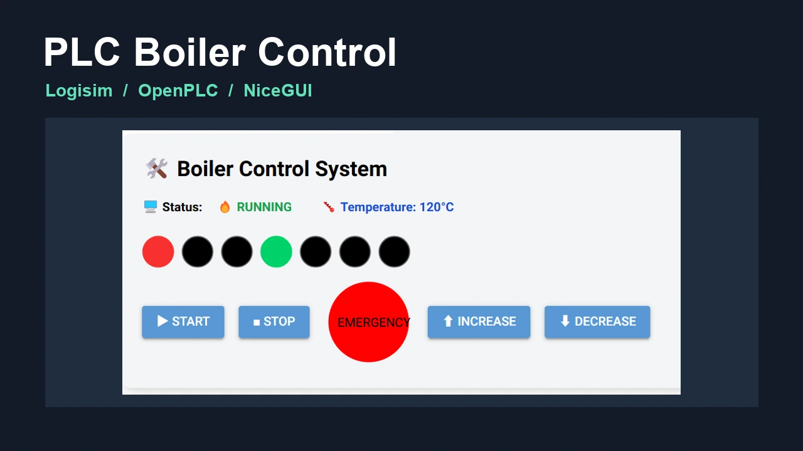
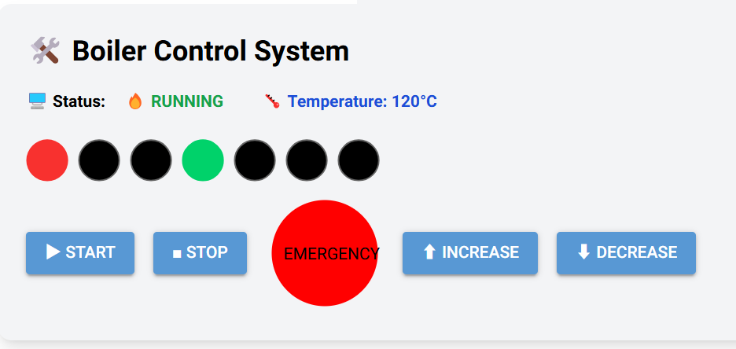
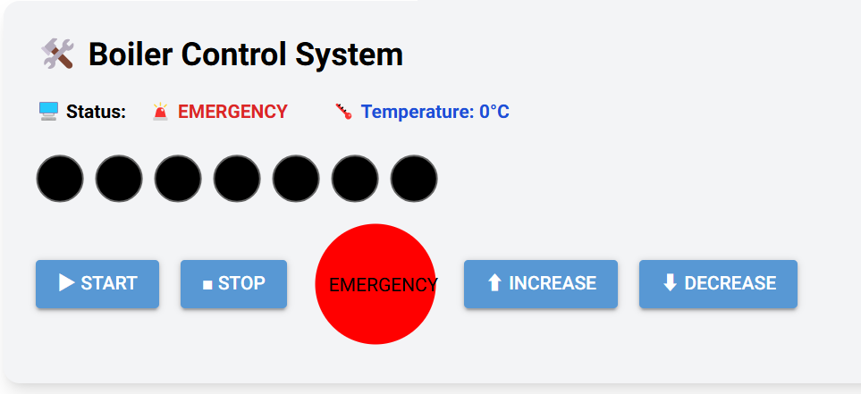
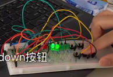
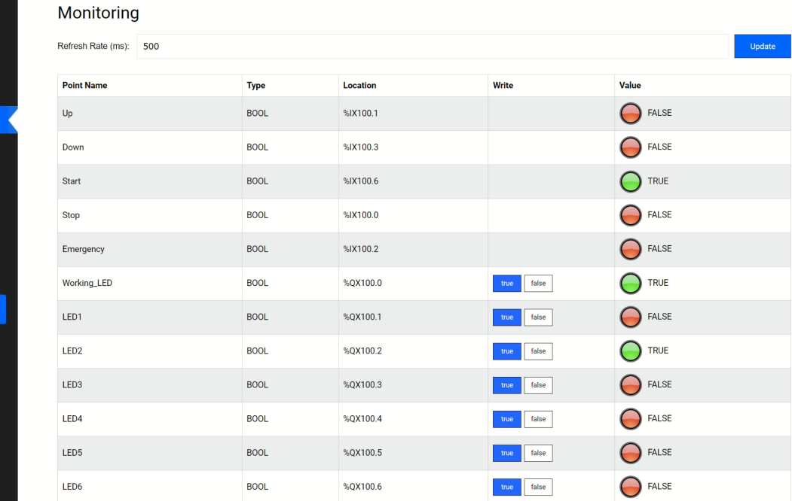
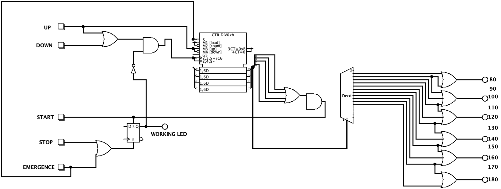

# PLC Boiler Control & Web Monitoring System

[Thumbnail](assets/thumbnail.webp) · [GitHub README](README.md) · [Architecture diagram](README.md#system-architecture)

## 中文简介

我与队友分三个阶段完成锅炉控制教学原型。我们先在 Logisim Evolution 中用计数器、译码器和 D 触发器验证控制规则，再将 OpenPLC 梯形图部署到 Raspberry Pi Pico，用实体按钮与 LED 演示运行、停机和急停复位。我参与电路、梯形图及 Python/NiceGUI 界面的开发，并负责第四阶段演示视频的录制与剪辑。调试发现 Modbus 写入偶发丢失、界面与设备状态同步存在延迟。课程成果展示了台架逻辑与界面交互，双向控制的可靠性仍有待验证。

## English Introduction

In this two-person Automation and Embedded Systems project, we built a boiler-control prototype around a sequence of progressively more concrete tests. We first used Logisim Evolution to model the setpoint counter, start conditions, and emergency reset. We then implemented the control logic in OpenPLC and exercised it with pushbuttons and LED indicators on a Raspberry Pi Pico bench. The final stage added a Python and NiceGUI browser interface that polled discrete inputs and coils and attempted output writes over a serial Modbus connection.

I co-developed the circuit and ladder logic, helped edit the HMI code, and recorded and edited the final demonstration. The main integration challenge was determining whether an action shown in the browser had reached the Pico. During testing, some writes were delayed or missed, while the interface still updated its local state and displayed feedback. The coursework demonstrated the physical button and LED sequence and the HMI workflow. Reliable browser-to-device actuation remained unresolved.

## Technical Details

- **Stack** · Logisim Evolution, OpenPLC, Ladder Diagram, Structured Text, Pico GPIO, Python, NiceGUI, PyModbus and pySerial.
- **Contribution** · Shared circuit, ladder logic and HMI code, plus documentation and video production.
- **Engineering challenge** · Comparing local UI state with physical outputs when Modbus writes were intermittent.
- **Result** · Bench input/output behavior and the HMI state transitions were demonstrated. The browser write path remained unreliable.

## Screenshot Gallery

[Image credits and source locations](docs/image-index.md)
