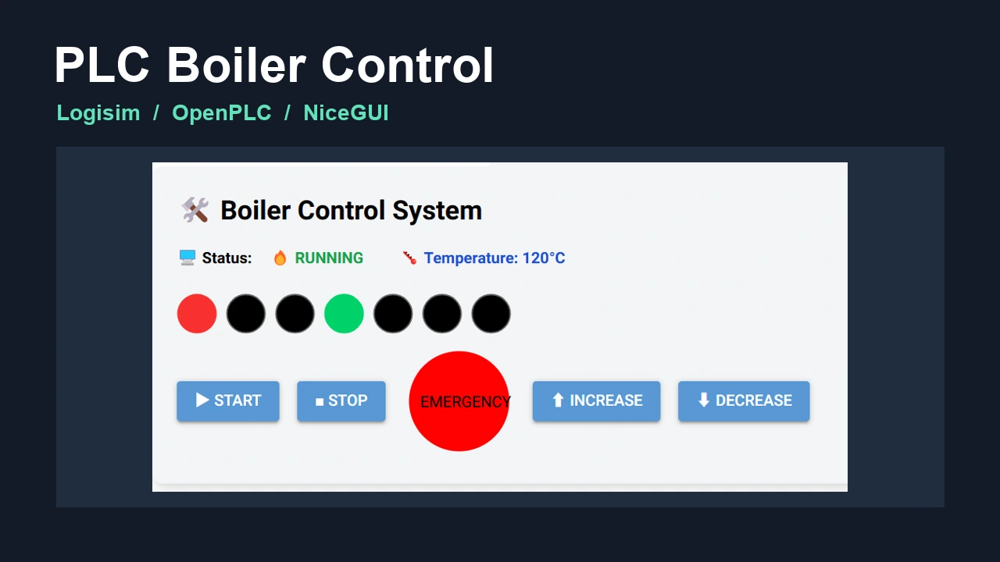
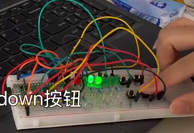
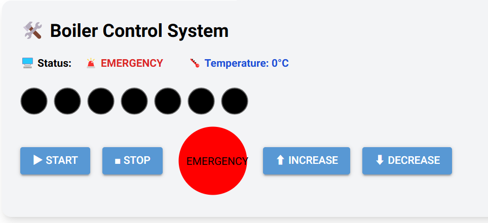
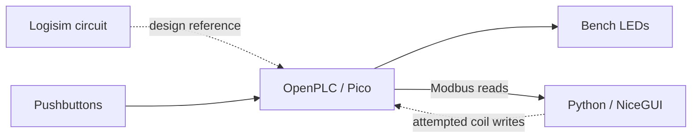

# PLC Boiler Control & Web Monitoring

I worked on the Logisim circuit, OpenPLC ladder logic, and Python web interface for an undergraduate boiler-control bench. Pushbuttons and LEDs represent the controls and outputs. The temperature shown in the browser is the selected setpoint.

## Screenshots & Demonstrations

| Raspberry Pi Pico bench | NiceGUI emergency reset |
| --- | --- |
|  |  |

[Logisim circuit](assets/screenshots/logisim-boiler-logic.png) · [OpenPLC monitor](assets/screenshots/openplc-runtime-monitor.png) · [Running HMI](assets/screenshots/nicegui-running-panel.png)

**Videos** · [Boiler Control Logic Demo](assets/demos/logisim-boiler-state-sequence.mp4) · [Raspberry Pi Pico Hardware Demo](assets/demos/openplc-pico-button-and-led-sequence.mp4) · [NiceGUI Web Interface](assets/demos/nicegui-emergency-interface.mp4)

## Tech Stack

Logisim Evolution · OpenPLC Editor and Runtime · IEC 61131-3 Ladder Diagram and Structured Text · Raspberry Pi Pico GPIO · Python, NiceGUI, PyModbus and pySerial

## Implementation

- **Digital logic.** A 4-bit up/down counter stores 12 setpoint levels. A decoder drives the temperature LEDs, and a D flip-flop holds the RUN state. Start requires a nonzero setpoint. While running, the adjustment buttons are gated off. Emergency reset clears both the setpoint and RUN state.
- **PLC bench.** The ladder program uses a CTUD counter, comparisons, and OR logic to drive six temperature LEDs and a run indicator. The Pico reads physical buttons and drives the LEDs through GPIO.
- **Web HMI.** The Python interface discovers the Pico’s USB serial port and polls discrete inputs and coils every 500 ms. Its controls update the browser state and attempt Modbus coil writes. During the lab, intermittent writes left the browser state and physical outputs out of sync.

## Code

- [Logisim circuit](src/logisim/boiler-control.circ)
- [OpenPLC project and board settings](src/openplc) · [Structured Text exports](src/openplc/st-exports) (base and offset I/O variants)
- [Python HMI](src/hmi/main.py)

The Structured Text exports retain the OpenPLC Runtime debugger notices for Autonomy and GP Orcullo. [GPL version 2 text](src/openplc/st-exports/LICENSE-GPL-2.0.txt)
