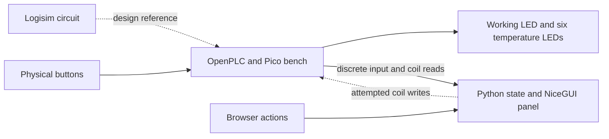

# PLC Boiler Control & Web Monitoring System

## Project Overview

A laboratory boiler-control prototype built in three stages. We modeled the control rules in Logisim Evolution, implemented physical button and LED behavior with OpenPLC and a Raspberry Pi Pico, and added a local browser HMI in Python. The displayed temperature is a stepped setpoint.

## Course Demonstration Videos

These MP4 excerpts come from the original course recordings. Open a video below to view or download the recording on GitHub.

| Exercise | Course recording |
| --- | --- |
| Logisim | [Setpoint, RUN and reset sequence (MP4)](assets/demos/logisim-boiler-state-sequence.mp4) |
| OpenPLC / Pico | [Physical buttons and LED indicators (MP4)](assets/demos/openplc-pico-button-and-led-sequence.mp4) |
| NiceGUI | [Browser panel after emergency reset (MP4)](assets/demos/nicegui-emergency-interface.mp4) |

[Video source and timestamps](docs/video-index.md) · [Report screenshots](docs/image-index.md)

## My Role & Contributions

I co-developed the Logisim circuit and OpenPLC ladder logic and organized documentation for those stages. For the HMI, I shared code editing with my teammate and recorded and edited the demonstration video.

## Tech Stack

- **Digital logic.** Logisim Evolution, counter, decoder, D flip-flop and logic gates.
- **Bench control.** OpenPLC Editor and Runtime, IEC 61131-3 Ladder Diagram and Structured Text, Raspberry Pi Pico GPIO.
- **Web and device interface.** Python, NiceGUI, PyModbus serial client and pySerial USB discovery.

## System Architecture

## Implementation

- A 4-bit counter models levels 0 through 11. The LEDs remain off at zero, start requires a nonzero setpoint, adjustment is gated while running, and the emergency input resets the counter and RUN state.
- The PLC ladder design uses a CTUD counter, equality comparisons and OR groups for LED patterns. The submission includes an OpenPLC project and several ST exports with differing I/O mappings.
- The saved Python script discovers the Pico serial port and polls discrete inputs and coils on a 0.5-second timer. Five handlers update local state and attempt to write output coils. The browser indicators render that local state.

## Challenges & Solutions

The team adjusted Modbus settings, checked the hardware connection and inspected the protocol while investigating missed writes and delayed updates. Immediate UI state changes and notifications kept the control workflow visible in the demo. The report describes diagnostic and retry snippets. The retained script catches write exceptions without logging or retrying and does not check the write response.

## Results & Limitations

The course record shows the physical button and LED sequence and the browser's RUN, STOP and EMERGENCY states. Reliable browser-to-Pico actuation remained unresolved. A browser notification confirms the local software action only. The emergency action was a lab state transition. The observations above come from the original coursework.

## Source

The repository contains the [Logisim circuit](src/logisim), [OpenPLC project and Structured Text exports](src/openplc) and [NiceGUI HMI](src/hmi). The [source layout](docs/reproduction.md) documents each artifact and its configuration limits.

[Evidence map](docs/evidence-map.md) · [Image index](docs/image-index.md) · [Portfolio copy](PORTFOLIO.md) · [Publication checklist](PUBLISH-CHECKLIST.md)
