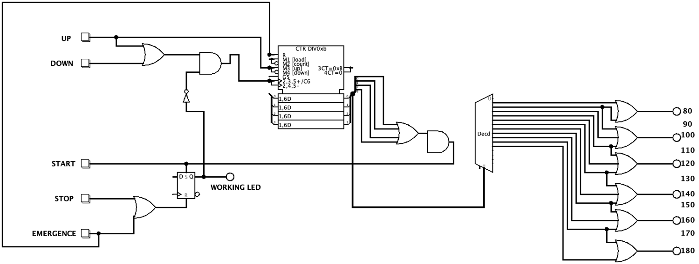
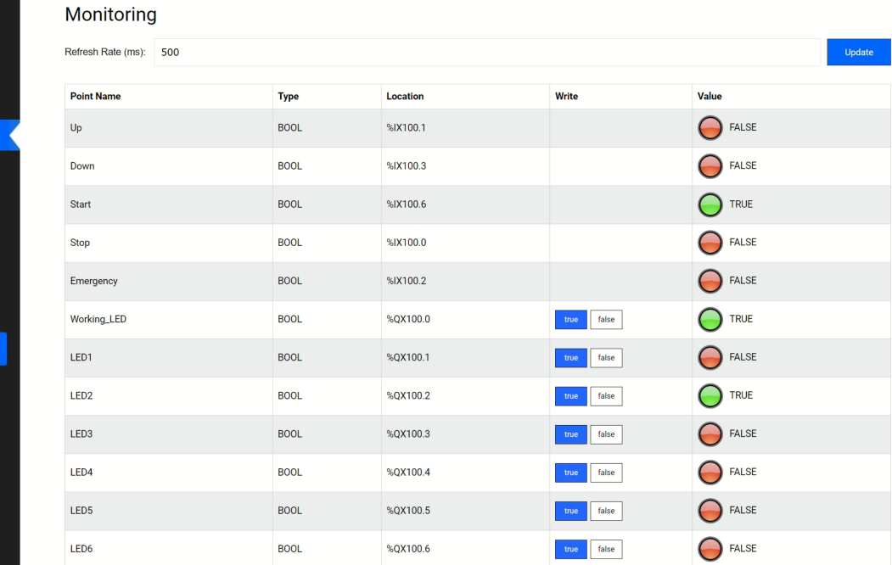
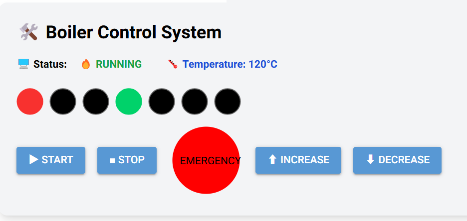
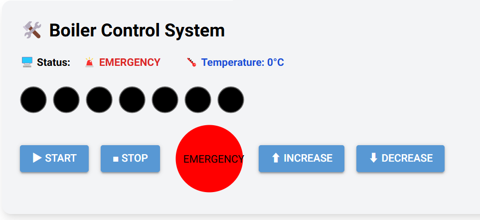
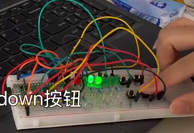

# Image Index

Page numbers refer to the local PDF renders of the original reports. See the [source key](evidence-map.md#source-key). The cover and thumbnail use the nicegui-running-panel screenshot with added title typography.

| File | Source | Page or time | Embedded file | Content |
| --- | --- | --- | --- | --- |
|  | A1 | 1 | image2.png | Logisim circuit overview |
|  | A3 | 5 | image7.png | OpenPLC variable monitor during the bench sequence |
|  | A4 | 2 | image2.png | Browser HMI showing RUNNING and an indicated setpoint |
|  | A4 | 4 | image4.png | Browser HMI showing emergency reset |
|  | Part3-Task2-Video.mp4 | 00:16 | video frame | Pico bench wiring and illuminated indicators |

The two HMI images crop the browser content and mask the shared team banner. The OpenPLC image crops out browser chrome. The bench frame is cropped from the original demonstration video.
